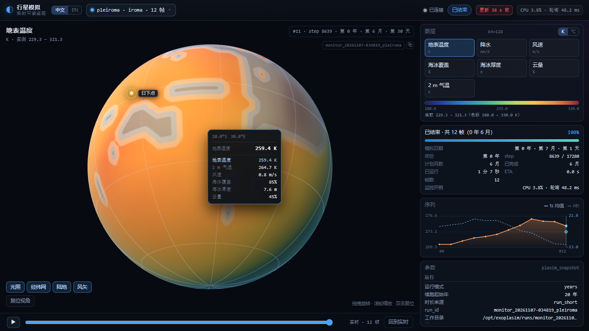
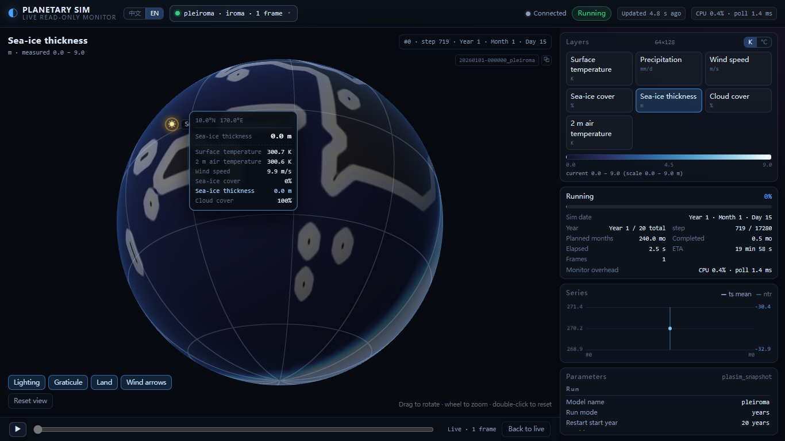
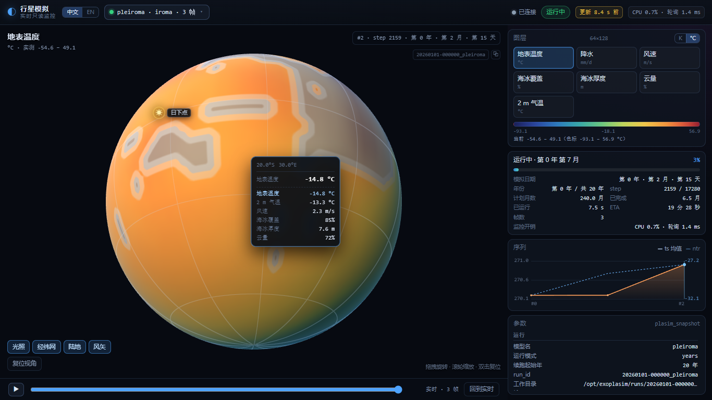
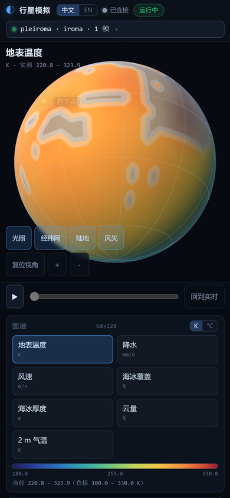
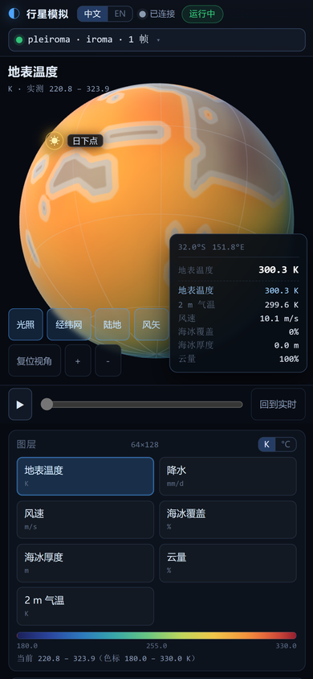
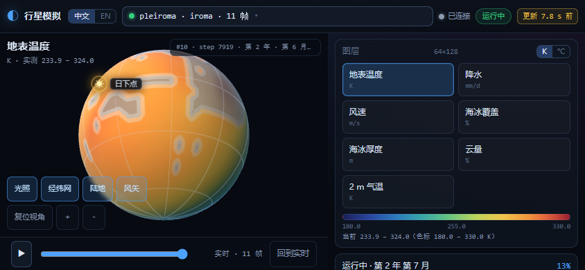
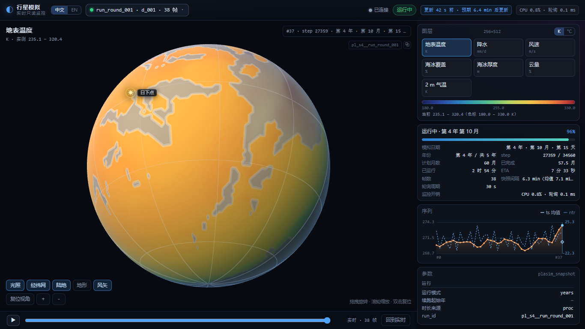
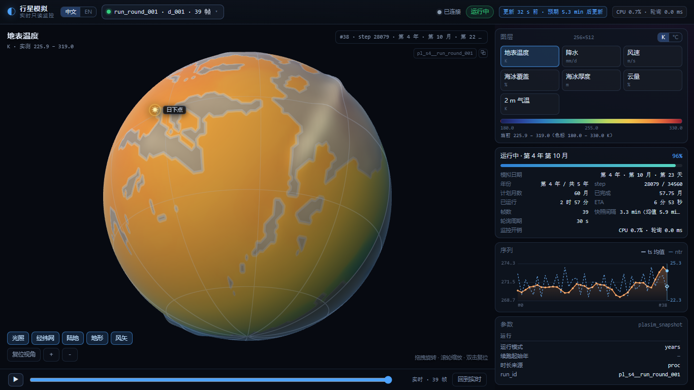

# ExoPlaSim Live Monitor

A **read-only, zero-dependency** web monitor for a running [ExoPlaSim](https://github.com/alphaparrot/ExoPlaSim)
simulation: watch a 3D globe with switchable layers (temperature, precipitation, wind,
sea-ice cover/thickness, cloud cover), the run parameters, progress, and frame history —
without touching the model process.

* **Read-only by construction** — the collector only `stat()`s and reads the raw files
  the model is already writing. Run with and without the monitor, the archived output is
  bit-for-bit identical (104/104 variables).
* **Real-time** — parses the growing `plasim_snapshot` file incrementally, one 15-day
  frame every few seconds. Measured publish latency max 0.81 s.
* **Low overhead** — 1 Hz polling, only new bytes are read. Measured 0.24 % mean /
  1.00 % max of one core per run, ~2 ms per poll, ≈100 MB RSS.
* **Multi-run** — several simulations can run at once; the top-bar selector switches
  between them (`?run=<run_id>` deep link).
* **Any resolution** — T21/T42/T85 raw snapshots (64×128 … 256×512) are parsed
  generically; a live 32-rank T85 run with a 493 MB snapshot produced 25 frames.
* **Bilingual UI** — 中文 / English toggle (`?lang=en`).
* **Adaptive polling** — the frame period is measured from the raw file's `mtime`
  (snapshot generation time). Idle runs poll up to 30 s apart, but a `mtime` change
  wakes the collector on the next 1 s tick, so new frames still appear immediately.
  T85 (32 ranks, 256×512) runs at ≈1–1.5 % CPU / ≈300 MB RSS.
* **PC + phone** — responsive layout for desktop and portrait/landscape phones; touch
  drag, pinch zoom and tap-to-read; works over the local network / hotspot.
* **Zero dependencies** — hand-written WebGL2 globe; no npm, no CDN, no three.js.



English UI (`?lang=en`) and Celsius mode:




---

## Quick start

```powershell
# Windows + WSL2, from the repository root
pwsh -NoProfile -File ".\monitor\start.ps1"
```

Then open the URL printed by `start.ps1` (normally <http://127.0.0.1:8765/>; if Windows has 8765 in a WSL/Hyper-V reserved port range it automatically falls back, e.g. 8665, and warns). It auto-discovers runs under
`/opt/exoplasim/runs`, waits for the API, and opens the browser.

| Flag | Meaning |
| --- | --- |
| `-Port 8770` | HTTP port |
| `-Workdir /opt/exoplasim/runs/<id>` | pin one run |
| `-NoBrowser` | do not open a browser |
| `-Foreground` | run the collector in the current console |
| `-Stop` | stop the collector |
| `-Lan` | also expose the page to the LAN / phone hotspot (admin; adds a port proxy + firewall rule) |
| `-LanRemove` | remove the LAN port proxy and firewall rule |
| `-ListenIp 192.168.137.1` | override the LAN listen address for `-Lan` |

### Phone / LAN access

The collector runs inside WSL2, so `127.0.0.1:8765` only exists on Windows. To watch from a
phone or another machine on the same network:

```powershell
pwsh -NoProfile -File ".\monitor\start.ps1" -Lan
```

`start.ps1` starts the collector and then runs `monitor/expose_lan.ps1` elevated, which adds
a Windows port proxy (`<LAN IP>:8765 → <WSL IP>:8765`) and a `LocalSubnet` firewall rule.
It prints the URL, for example:

```
[lan] 局域网/手机访问： http://192.168.137.1:8765/
```

Use that address on the phone (connect it to the computer's mobile hotspot or the same LAN). The helper uses the same port chosen by `start.ps1` (including the automatic fallback), so always use the printed URL.
WSL2's IP changes after `wsl --shutdown`, so re-run `start.ps1 -Lan` (or `expose_lan.ps1`)
after a WSL restart. `-LanRemove` cleans up. The script only exposes the collector port; the
monitor itself stays read-only.

No simulation yet? Create a 6-month test case (≈40 s on 8 cores):

```bash
/opt/exoplasim/env/bin/python monitor/test/run_short.py \
  --spec <your-spec>.json \
  --months 6 --outdir monitor/demo --ncpus 8
```
`<your-spec>.json` is any ExoPlaSim run specification (for Pleiroma, the preset
project's `preset/specs/pleiroma.json` plus a restart file works). See
[docs/DEPLOY.md](docs/DEPLOY.md) for a from-scratch installation ([中文](docs/DEPLOY.zh-CN.md)).

---

## User interface

* **3D globe** — equirectangular data texture + fragment-shader colour maps (LUT);
  drag to rotate, wheel to zoom, double-click to reset; lighting / graticule / coastline
  overlays are individually switchable. Only the **model frame** (rotation axis as pole)
  is used — the monitor deliberately focuses on the simulation itself.
* **3D terrain** — optional **Terrain** chip (off by default). Elevation comes from the raw spectral orography (code 129); the display is non-proportional: the current maximum elevation always maps to 5 % of the planet radius, so even a 2 km highland is visible. Mountains are shaded and the sphere silhouette is displaced.
* **Layers** — surface temperature `ts` (K), precipitation `pr` (mm/day), wind speed
  `spd` (m/s) with optional wind vectors, sea-ice **cover** `sic` (0–1), sea-ice
  **thickness** `sit` (0–9 m), cloud cover `clt` (0–1, shown as %), 2 m air temperature
  `tas` (K).
* **Hover readout** — move the pointer over the globe: reprojected latitude/longitude and
  the nearest-grid-cell value of the current layer plus `ts/tas/spd/sic/sit/clt`;
  pin a point with `?hover=<lat>,<lon>`. On touch screens, **tap** the globe to show the
  same card (tap elsewhere to dismiss).
* **Terrain toggle** — `地形` chip / `?terrain=1`; when off the globe is exactly the original sphere. On phones the same chip is available.
* **Touch controls** — drag to rotate, **pinch to zoom**, `+ / −` buttons, double-tap/双击复位;
  layout stacks the globe above the panels in portrait and uses a side-by-side layout in
  landscape. Safe-area insets are respected on notched phones.
* **Temperature units** — `K / °C` toggle (persisted, `?unit=c`); affects the colour-bar
  ticks, layer title and hover values.
* **Run selector** — all discovered runs with status/frame count, remembered in
  `localStorage`; `?run=<run_id>` deep link.
* **Parameters panel** — resolution/layers/ranks/timestep/snapshot interval, stellar flux
  and temperature, radius/gravity/rotation/eccentricity/obliquity, gas partial pressures
  (bar and ppmv), physics filter, boundary files, plus year/step/progress/ETA and the
  monitor's own CPU/poll cost.
* **Timeline** — `ts_mean` and `ntr` series, yearly points, history slider and playback;
  "back to live" returns to the newest frame.
* **Language** — 中文 / English switch; `?lang=en` deep link.
* **Self-test** — `http://127.0.0.1:8765/?selftest=1` (25 checks: API, EXOF parsing,
  WebGL2 render, hover sampling, touch tap, K→°C, i18n, pointer events, land mask, terrain, freshness colour,
  no horizontal overflow, no third-party requests).

Phone screenshots (iPhone-14 viewport, 390×844):




Landscape phone (844×390):



Terrain display (off / adaptive exaggerated):




---

## How it works

```
plasim_snapshot  ← the model appends one 15-day block at a time (authoritative live source)
plasim_output    ← same structure, monthly/diagnostic output (not required)
plasim_namelist / planet_namelist / radmod_namelist / <model>.cfg ← parameters
<outdir>/spec.json ← optional, richest parameter source (merged when available)
```

The collector (`monitor/collector/`) runs inside WSL, where the files are on ext4:

* reads only **newly appended bytes**, parses only **complete** Fortran records
  (`marker|header|marker|len|data|marker`), resets cleanly when a file is renamed or truncated;
* publishes a frame when the last record of a step (`code 329`, `gpi`) arrives and
  de-duplicates late records — this fixed an early duplicate-frame bug;
* derives fields with the same conventions as ExoPlaSim's `pyburn`:
  `pr = (code142 + code143) × 8.64e7` mm/day, `ntr = code178 + code179`,
  `sic = code210` (0–1), `sit = code211` (0–9 m), `clt = code164` (0–1);
  wind from divergence/vorticity spectral coefficients through
  `pyfft.spvgp(...)`, then `reshape(nlev,nlat,nlon)` and `roll(nlon//2)`, near-surface level;
* resamples the Gaussian grid to a uniform `2×nlat × 2×nlon` grid (T21 → 64×128);
* infers **years and planned length** from the running process (`exo_run.py --years N`,
  `--outdir/spec.json`, `run_short.py --months M`) and from completed `MOST.?????.npz`
  files, because the model itself resets `step` every year and always writes a 1-year
  namelist while `exo_run` loops `run(years=1)`.

HTTP API (see [CONTRACT.md](CONTRACT.md)):

| Endpoint | Description |
| --- | --- |
| `GET /api/runs` | all runs (active first) + status/frames/progress/summary + `default` |
| `GET /api/state?run=<id>` | grid, layer metadata, params, progress, history, year series, monitor cost |
| `GET /api/frame?run=<id>&id=<n\|latest>` | EXOF binary: 9 `nlat×nlon` float32 layers |
| `GET /api/land?run=<id>` | EXOF binary: land mask `lsm` |
| `GET /` | static frontend |

---

## Verification (measured on this project, T21, 6 model months / 12 frames)

| Item | Result |
| --- | --- |
| Frames | 12, steps `[719, 1439, …, 8639]`, strictly increasing, no duplicates |
| Latency | max **0.81 s**, mean 0.67 s |
| CPU (collector) | mean **0.24 %**, max **1.00 %** of one core |
| Poll | max 5.20 ms, mean 1.99 ms |
| RSS | ≈100 MB (including pyfft) |
| Numeric check vs archived `.npz` | 12 frames: `max|Δts| = max|Δpr| = max|Δsic| = max|Δsit| = 0`; with `--no-physfilter` also `Δu = Δv = 0` |
| Read-only proof | run with/without monitor: archived `.npz` **104/104 variables bit-identical** |
| Years / plan | 6-month run: `year_no=0`, `planned_months=6`; a 20-year run (`exo.ps1 -Years 20`) is reported as `year_no=0`, `planned_months=240`, `year_total=20`, `restart_year=20`; the estimate persists after the process is killed |
| Cross-year (5 years, 2 h timestep) | 180 frames; year sequence 0→1→2→3→4 with each transition `(Y, 12, 30) → (Y+1, 1, 20)`; no `第 N+1 年 · 第 12 月` jump. Script: `test/watch_crossyear.py` |
| Multi-run | two concurrent 6-month runs both live, each with 12 frames; cross-session runs are listed too, including nested `<root>/<case>/run_round_NNN/` workdirs |
| API verifier | `test/verify_api.py` → **ALL CHECKS PASSED** |
| Frontend self-test | **25/25** against the real collector (zh and en; includes pointer hover, touch tap, land mask, terrain, freshness colour, no horizontal overflow, i18n, K→°C) |
| Phone layout | iPhone-14 emulation 390×844 + landscape 844×390: no horizontal overflow, tap readout, pinch/zoom buttons; screenshots above |
| LAN access | `start.ps1 -Lan` → port proxy + `LocalSubnet` firewall rule; `http://192.168.137.1:8765/` returns 200 from the host; `-LanRemove` cleans up |
| Terrain | `/api/land` now returns `order=["lsm","oro"]`; `地形` / `?terrain=1` displaces the mesh to 5 % radius at the current max elevation, off by default; T85 max ≈28.7 km |
| Raw header recovery | `collector/selftest_rawburn.py`: zero prefix → partial header (offset stays 0) → valid header → truncate → rewrite, **ALL PASS**; a live T85 (256×512, 493 MB) run lists 25 frames |
| Adaptive polling | T85 frame period ≈30–40 s → idle poll ≈9 s (cap 30 s); a 105 s probe measured the next frame within ≤0.5 s of the raw file's `mtime` change. CPU ≈1–1.5 %, RSS ≈300 MB (chunked reads). `--no-adaptive` restores fixed `--interval` |

This repository also keeps a small harness for fast iteration:

* `test/run_short.py` — a ≤6-model-month run (physics unchanged, only the integration
  interval is shortened) so UI work does not wait for years of simulation;
* `test/verify_api.py` — HTTP-only acceptance: EXOF parsing, grid, layers, multi-run,
  and numeric comparison against an archived snapshot;
* `test/make_fixture.py` + `test/mock_server.py` — record a fixture from any archived
  `.npz` and replay it through the exact same API (frontend development without a run).

---

## Repository layout

```
monitor/
├── start.ps1 / launch_collector.sh   Windows launcher + WSL foreground launcher
├── expose_lan.ps1                    optional LAN/phone port proxy + firewall (admin)
├── start.sh                          manual WSL start
├── CONTRACT.md                       API/format contract (Chinese; code comments in English)
├── README.md / README.zh-CN.md       this file, in English / Chinese
├── docs/DEPLOY.md / DEPLOY.zh-CN.md  from-scratch deployment & debugging
├── collector/                        read-only parser, state, discovery, HTTP server
├── web/                              zero-dependency WebGL2 frontend + i18n
└── test/                             short-run harness, API verifier, fixture & mock
```

---

## Known limitations

1. **Finished multi-year runs** whose process and `spec.json` are both unavailable cannot
   reveal their planned length; the monitor falls back to the completed-year count (≥2
   years) or the namelist's 1 year. Live runs are always inferred correctly.
2. Wind matching an archived `.npz` exactly requires `--no-physfilter` (archives are
   written without the physics filter); the default display uses the filter.
3. History is kept in memory (48 frames/run); restarting the collector loses history for
   runs whose raw files are already gone.
4. Only T21 (64×128) is validated with real data; T42 (128×256) follows the same generic
   path but has not been long-tested here.
5. The collector must run where `/opt/exoplasim/runs` is readable (WSL). It is not a
   remote agent; extend it if you need to monitor a different host.

---

## Related project: terrain-stacking coupling

The [`coupling/`](../coupling/README.md) subproject of this repository runs ExoPlaSim externally
with rewritten `.sra` boundary files to bypass the 9 m sea-ice thickness cap and the 5 m snow cap.
Its runs live under `/opt/exoplasim/runs/`, so this monitor discovers them automatically
(the 20-year `pleiroma_20yr_orig` / `pleiroma_20yr_fix` pair was verified with 480 frames each;
`stack_pilot2`, `xmaxd_3round`, etc. also show up). The monitor is read-only and does not
affect the coupling scripts.

- Overview / commands: [../coupling/README.md](../coupling/README.md)
- Design: [../coupling/docs/DESIGN.md](../coupling/docs/DESIGN.md)

---

## License

The monitor code is released under the MIT License (see [LICENSE](LICENSE)).
ExoPlaSim itself is a separate GPL-3.0 project; this repository only **reads** its
output files and does not include ExoPlaSim source or binaries.
