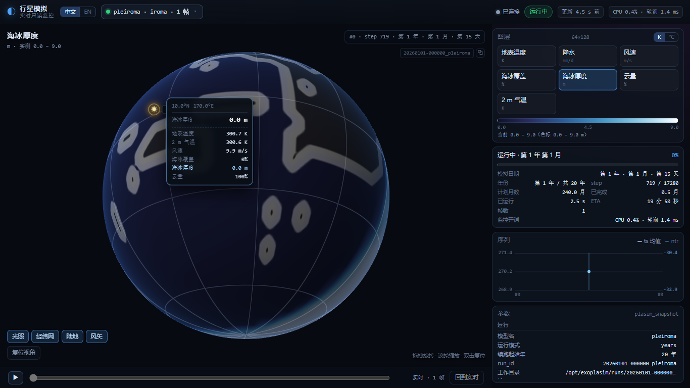
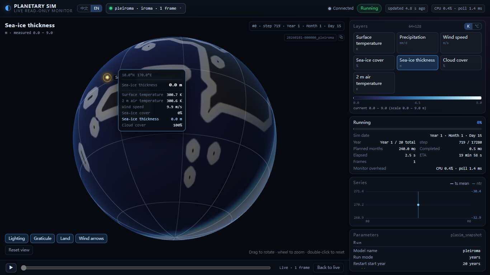
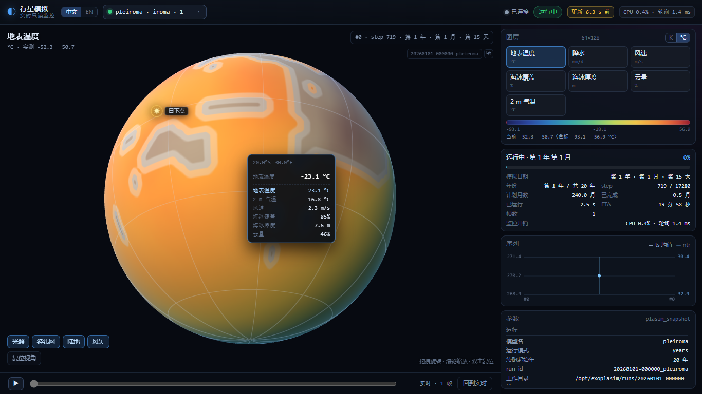

# ExoPlaSim 实时监控器

给正在运行的 [ExoPlaSim](https://github.com/alphaparrot/ExoPlaSim) 模拟做一个**只读、零依赖**的
网页监控：3D 球体上可切换图层（温度 / 降水 / 风力 / 海冰覆盖 / 海冰厚度 / 云量）、
运行参数、进度和历史帧——而且**不碰模型进程**。

* **只读**：collector 只 `stat()`/读取模型本来就在写的 raw 文件。同一算例开/关监控，
  归档 npz **104/104 个变量逐点完全相同**。
* **实时**：增量解析正在增长的 `plasim_snapshot`，每 15 天一个快照，
  实测发布延迟最大 **0.81 s**。
* **开销小**：1 Hz 轮询、只读新追加字节；实测单核 **mean 0.24% / max 1.00%**，
  轮询约 2 ms，RSS ≈100 MB。
* **多模拟**：可同时监控多个 run，顶栏切换（`?run=<run_id>` 深链）。
* **中英双语**：中文 / English 切换（`?lang=en`）。
* **零依赖**：手写 WebGL2 球体，不需要 npm / CDN / three.js。



英文界面（`?lang=en`）与摄氏度模式：




---

## 快速开始

```powershell
# Windows + WSL2，在仓库根目录
pwsh -NoProfile -File ".\monitor\start.ps1"
```

打开 <http://127.0.0.1:8765/>。`start.ps1` 会自动发现 `/opt/exoplasim/runs` 下的 run，
等 API 就绪后打开浏览器。

| 参数 | 作用 |
| --- | --- |
| `-Port 8770` | 换端口 |
| `-Workdir /opt/exoplasim/runs/<id>` | 固定某个 run |
| `-NoBrowser` | 不开浏览器 |
| `-Foreground` | 前台运行（调试） |
| `-Stop` | 停止 collector |

还没有模拟？先跑一个 **6 个模拟月** 的测试算例（8 进程约 40 s）：

```bash
/opt/exoplasim/env/bin/python monitor/test/run_short.py \
  --spec verify/pleiroma/batch1_T21_20yr/specs/pleiroma_continue.json \
  --months 6 --outdir monitor/demo --ncpus 8
```

从零部署见 [docs/DEPLOY.zh-CN.md](docs/DEPLOY.zh-CN.md)（[English](docs/DEPLOY.md)）。

---

## 界面

* **3D 球体**：等经纬数据纹理 + 片元着色色标（LUT）；拖拽旋转、滚轮缩放、双击复位；
  光照 / 经纬网 / 陆地描边可独立开关。**只使用模型系**（自转轴为极），监控器聚焦模拟本身。
* **图层**：地表温度 `ts`(K)、降水 `pr`(mm/d)、风速 `spd`(m/s)+风矢、海冰覆盖 `sic`(0–1)、
  **海冰厚度 `sit`(m, 0–9)**、云量 `clt`(0–1，按 % 显示)、2m 气温 `tas`(K)。
* **悬停读数**：鼠标指到球面 → 显示该点经纬度、当前图层值，以及 `ts/tas/spd/sic/sit/clt`
  的最近格点值；`?hover=<lat>,<lon>` 可固定一点。
* **温度单位**：`K / °C` 切换（记忆 + `?unit=c`），影响色标刻度、标题和悬停值。
* **多模拟选择器**：列出所有发现的 run（状态/帧数），localStorage 记忆；`?run=` 深链。
* **参数面板**：分辨率/层数/进程/时间步/快照间隔、恒星流量与温度、半径/重力/自转/偏心率/倾角、
  大气分压（bar 与 ppmv）、物理滤波、边界文件；以及年/step/进度/ETA 和监控自身开销。
* **时序与回溯**：`ts_mean` / `ntr` 折线、年度点、历史帧滑块与播放；「回到实时」恢复最新帧。
* **语言**：中文 / English 切换；`?lang=en` 深链。
* **自检**：`http://127.0.0.1:8765/?selftest=1`（20 项：API、EXOF、WebGL2、悬停采样、
  K→°C、i18n、无第三方请求）。

---

## 工作原理

```
plasim_snapshot  ← 模型每 15 天追加一个时间块（权威实时源）
plasim_output    ← 同结构的另一份输出（月均/诊断，监控不依赖）
plasim_namelist / planet_namelist / radmod_namelist / <model>.cfg ← 参数
<outdir>/spec.json ← 可选，参数最全（有则合并）
```

collector（`monitor/collector/`）跑在 WSL 里（文件在 ext4 上）：

* 只读**新追加的字节**、只解析**完整**的 Fortran record
  （`marker|header|marker|len|data|marker`），文件被改名/截断时自动重置；
* 一帧的收尾信号是每个 step 最后一条记录（`code 329 gpi`），并对迟到的同 step 记录去重
  ——这修掉了早期版本的重复帧；
* 派生口径与 ExoPlaSim 的 `pyburn` 一致：
  `pr = (code142 + code143) × 8.64e7` mm/day，`ntr = code178 + code179`，
  `sic = code210`（0–1），`sit = code211`（0–9 m），`clt = code164`（0–1）；
  风场由散度/涡度谱系数经 `pyfft.spvgp(...)`，再 `reshape(nlev,nlat,nlon)` 与
  `roll(nlon//2)`，取近地面层；
* 高斯网格重采样到均匀 `2×nlat × 2×nlon`（T21 → 64×128）；
* **年份与计划时长**：模型每年 `step` 归零、namelist 永远写 1 年，所以年份用已完成的
  `MOST.?????.npz` 计数，计划时长从运行进程（`exo_run.py --years N`、
  `--outdir/spec.json`、`run_short.py --months M`）推断。

HTTP API（详见 [CONTRACT.md](CONTRACT.md)）：

| 接口 | 说明 |
| --- | --- |
| `GET /api/runs` | 所有 run（活跃优先）+ 状态/帧数/进度/摘要 + `default` |
| `GET /api/state?run=<id>` | 网格、图层元数据、参数、进度、history、年度序列、监控开销 |
| `GET /api/frame?run=<id>&id=<n\|latest>` | EXOF 二进制：9 个 `nlat×nlon` float32 图层 |
| `GET /api/land?run=<id>` | EXOF 二进制：陆地掩膜 `lsm` |
| `GET /` | 前端静态页 |

---

## 验收（T21，6 个模拟月 / 12 帧）

| 项 | 结果 |
| --- | --- |
| 帧数 / step | 12 帧，`[719, 1439, …, 8639]`，严格递增无重复 |
| 实时延迟 | max **0.81 s** / mean 0.67 s |
| 自身 CPU | **mean 0.24% / max 1.00%**（单核） |
| 轮询耗时 | max 5.20 ms / mean 1.99 ms |
| RSS | ≈100 MB（含 pyfft） |
| 与归档 npz 对照 | 12 帧：`max\|Δts\| = max\|Δpr\| = max\|Δsic\| = max\|Δsit\| = 0`；`--no-physfilter` 时 `Δu=Δv=0` |
| 只读性 | 开/关监控，归档 npz **104/104 变量逐点相同** |
| 年份 / 计划 | 6 个月 run：`year_no=1`、`planned_months=6`；20 年 run（`exo.ps1 -Years 20`）：`year_no=1`、`planned_months=240`、`year_total=20`、`restart_year=20`，杀掉进程后仍保持 |
| 多 run | 两个并发 6 个月算例各自 12 帧；跨会话 run 也能同时监控 |
| 独立验收 | `test/verify_api.py` → **ALL CHECKS PASSED** |
| 前端自检 | 对真实 collector **20/20**（中英文各一次） |

仓库里还带一套快速迭代工具：

* `test/run_short.py` —— 最长 6 个模拟月的短跑（物理不变，只截短积分区间），
  做界面不必等整年/多年；
* `test/verify_api.py` —— 只走 HTTP 的独立验收：EXOF、网格、图层、多 run、
  与归档快照逐点对照；
* `test/make_fixture.py` + `test/mock_server.py` —— 从任意归档 `.npz` 生成 fixture，
  再用完全一致的接口回放（前端无需真实 run 即可开发）。

---

## 目录

```
monitor/
├── start.ps1 / launch_collector.sh   Windows 启动器 + WSL 前台启动脚本
├── start.sh                          手工在 WSL 内启动
├── CONTRACT.md                       接口/格式契约（中文；代码注释为英文）
├── README.md / README.zh-CN.md       英/中说明
├── docs/DEPLOY.md / DEPLOY.zh-CN.md  新设备部署与调试教程
├── collector/                        只读解析、状态、发现、HTTP 服务
├── web/                              零依赖 WebGL2 前端 + i18n
└── test/                             短跑 harness、API 验收、fixture 与 mock
```

---

## 已知限制

1. **已结束的多**年** run**，如果进程和 `spec.json` 都拿不到，计划总年数无法得知：
   会退回「已完成年数」（≥2 年时）或 namelist 的 1 年。运行中的 run 总是能推断正确。
2. 风场要与归档 `.npz` 精确一致需 `--no-physfilter`（归档默认不开物理滤波）；
   界面默认开滤波。
3. 历史帧在内存里（48 帧/run）；collector 重启后，raw 已被删除的 run 会丢失历史。
4. 只用 T21（64×128）做过真实数据验收；T42（128×256）走同一套通用逻辑，但未长测。
5. collector 必须跑在能读到 `/opt/exoplasim/runs` 的环境（WSL）；它不是远程 agent，
   要监控其他主机需自行扩展。

---

## 许可

监控器代码采用 MIT License（见 [LICENSE](LICENSE)）。
ExoPlaSim 本身是独立的 GPL-3.0 项目；本仓库只**读取**它的输出文件，
不包含 ExoPlaSim 源码或二进制。
